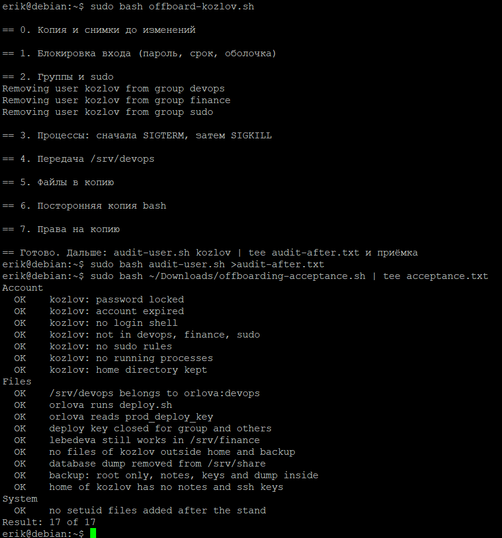

# Журнал работ · ТЗ № 3 · ops-03, закрытие доступа kozlov

Пишется по ходу работы, а не в конце. Ошибки и откаты тоже записываются.
Этап: сбор сведений для паспорта сервера (до первых изменений). Работа выполняется одним человеком.

| Время | Кто | Команда | Результат | Требование | Зачем |
|---|---|---|---|---|---|
| 13:05 | Эрик | `script -a ~/session.log` | запись сеанса терминала идёт в `/home/erik/session.log` | — | сохранить вывод команд для журнала и акта |
| 13:07 | Эрик | `sudo bash ~/Downloads/offboarding-stand.sh` | `ops-03: kozlov has 3 processes` | — | развернуть копию сервера |
| 13:10 | Эрик | `cat /etc/os-release` | Debian GNU/Linux 13 (trixie) | — | версия системы для паспорта |
| 13:11 | Эрик | `uname -r` | `6.12.107+deb13-amd64` | — | версия ядра для паспорта |
| 13:12 | Эрик | `hostnamectl` | хост `debian`, VirtualBox, x86-64 | — | тип машины и архитектура |
| 13:15 | Эрик | `id kozlov; id orlova; id lebedeva` | kozlov в группах sudo, devops, finance; orlova в devops; lebedeva в finance | 2.1.2 | какие группы нужно убрать у kozlov |
| 13:17 | Эрик | `getent passwd kozlov orlova lebedeva` | у всех троих оболочка `/bin/bash`, домашние `/home/<имя>` | 2.1.1 | текущая оболочка kozlov до смены на nologin |
| 13:18 | Эрик | `getent group devops finance sudo` | devops: kozlov, orlova; finance: kozlov, lebedeva; sudo: erik, kozlov | 2.1.2 | состав групп до изменений |
| 13:20 | Эрик | `passwd -S kozlov` | ошибка: `You may not view or modify password information for kozlov.` | 2.1.1 | статус пароля; не получилось без sudo, см. ниже |
| 13:21 | Эрик | `chage -l kozlov` | ошибка: `chage: Permission denied.` | 2.1.1 | срок действия учётной записи; не получилось без sudo, см. ниже |
| 13:23 | Эрик | `sudo -l -U kozlov` | `(ALL : ALL) ALL` и `(ALL) NOPASSWD: ALL` | 2.1.2 | какие права root есть у kozlov |
| 13:25 | Эрик | `sudo grep -rn kozlov /etc/sudoers /etc/sudoers.d` | найдено `/etc/sudoers.d/90-kozlov:1: kozlov ALL=(ALL) NOPASSWD: ALL` | 2.1.2 | найти файл с личным правилом sudo |
| 13:28 | Эрик | `ps -eo user,pid,ppid,lstart,cmd --sort=user` | кроме системных и erik есть 3 процесса kozlov (PID 1578, 1580, 1725) | 2.1.3 | список процессов и владельцев |
| 13:30 | Эрик | `ps -u kozlov -o pid,ppid,lstart,cmd` | `sync-tunnel.sh` (1578), `http.server 8000` (1580), дочерний `sleep 30`; родитель обоих основных процессов — PID 1 | 2.1.3 | записать, что делают процессы, до завершения |
| 13:32 | Эрик | `sudo ss -ltnp` | порт 22 (sshd) и `0.0.0.0:8000` (python3, pid 1580) | 2.1.3 | найти открытые порты kozlov |
| 13:35 | Эрик | `df -h` | `/` 37G, занято 4%; `/boot` 943M, занято 8% | — | заполнение разделов для паспорта |
| 13:36 | Эрик | `free -h` | ОЗУ 3.8 GiB, swap 2.0 GiB | — | память для паспорта |
| 13:38 | Эрик | `ls -ld /srv/devops /srv/finance /srv/share /home/kozlov` | `/srv/devops` kozlov:devops `drwxrws---`; `/srv/finance` lebedeva:finance `drwxrws---`; `/srv/share` `drwxrwxrwt`; `/home/kozlov` `drwx------` | 2.2.1 | владельцы и права каталогов до передачи |
| 13:40 | Эрик | `ls -lR /srv/devops` | ошибка: `Permission denied` | 2.2.1 | содержимое `/srv/devops`; не получилось без sudo, см. ниже |
| 13:41 | Эрик | `sudo ls -lR /srv/devops` | `deploy.sh` 750, `inventory.ini` 640, `prod_deploy_key` 600, все kozlov:devops | 2.2.1 | права файлов до смены владельца (сравнить после) |
| 13:44 | Эрик | `ls -la /srv/finance /srv/share /home/kozlov` | `/srv/share` показан; `/srv/finance` и `/home/kozlov`: `Permission denied` | 2.2.2, 2.3.2, 2.3.3 | содержимое каталогов; не получилось без sudo, см. ниже |
| 13:46 | Эрик | `sudo ls -la /srv/finance /srv/share /home/kozlov` | в `/srv/share` дамп `db_dump_2026-09-28.sql` (644, kozlov); в `/home/kozlov` есть `notes.txt` и `.ssh`; в `/srv/finance` файл `payments-2026-09.csv` | 2.2.2, 2.3.2, 2.3.3 | найти дамп, заметки и ключи; состояние каталога бухгалтерии |
| 13:50 | Эрик | `sudo chage -l kozlov` | пароль не истекает, `Account expires: never` | 2.1.1 | срок действия учётной записи kozlov до блокировки |
| 13:55 | Эрик | `sudo find / -xdev -user kozlov -not -path '/home/kozlov*' -ls 2>/dev/null` | 7 объектов: `/srv/devops` с `deploy`, `deploy.sh`, `inventory.ini`, `keys`, `prod_deploy_key` и дамп `/srv/share/db_dump_2026-09-28.sql` | 2.3.1 | найти все файлы kozlov вне домашнего каталога |
| 13:58 | Эрик | `sudo find / -xdev -perm -4000 -type f 2>/dev/null \| while read f; do dpkg -S "$f" >/dev/null 2>&1 \|\| echo "НЕ ИЗ ПАКЕТА: $f"; done` | вывод пустой: у всех файлов с setuid есть пакет | 2.3.4 | найти программы с setuid не из пакетов системы |
| 14:00 | Эрик | `sudo find / -xdev -perm -4000 -type f 2>/dev/null` | 10 файлов: `dbus-daemon-launch-helper`, `ssh-keysign`, `passwd`, `chsh`, `gpasswd`, `newgrp`, `umount`, `chfn`, `sudo`, `su`, `mount`; все системные | 2.3.4 | проверить, что поиск работает и пустой результат не ошибка |
| 14:03 | Эрик | `sudo find / -xdev -type f -perm /111 -newermt "2026-10-25 13:40" -not -path "/home/*" -not -path "/srv/*" -not -path "/var/lib/*" -not -path "/var/log/*" -ls 2>/dev/null` | найден `/var/tmp/.cache-k/kbash`, владелец root, `-rwxr-xr-x`, 1298416 байт, без бита setuid | 2.3.4 | найти оставленные программы, которых не нашёл поиск по setuid и по владельцу |
| 16:24 | Эрик | `sudo bash audit-user.sh kozlov \| tee audit-before.txt` | Сняты сведения до изменений: группы devops, finance, sudo; правило sudo NOPASSWD; 2 процесса (один слушает порт 8000); файлы вне дома в /srv и /srv/share; setuid-файл вне пакетов в /var/tmp/.cache-k | 2.1.2, 2.1.3, 2.3.1, 2.3.4 | Собрать сведения до блокировки: после неё часть данных не получить; вывод сохранён в audit-before.txt для акта |
| 17:22 | Эрик | `sudo install -d -m 700 -o root -g root /var/backups/offboarding/kozlov` | Каталог копии создан, root 700 | 2.3.2 | Подготовить копию до переноса файлов |
| 17:23 | Эрик | `sudo ls -lR /srv/devops \| sudo tee /var/backups/offboarding/kozlov/devops-ls-before.txt` | Каталоги 2770 kozlov:devops, deploy.sh 750, inventory.ini 640, ключ 600 | 2.2.1 | Снимок прав до передачи, чтобы сравнить после |
| 17:23 | Эрик | `sudo stat -c '%A %U:%G %n' /srv/devops/keys/prod_deploy_key` | `-rw------- kozlov:devops` | 2.2.1 | Зафиксировать права ключа до chown |
| 17:25 | Эрик | `sudo ps -o pid,ppid,lstart,cmd -u kozlov` | 3 процесса: 3296 sync-tunnel.sh и 3299 http.server 8000 (PPID 1, запущены 15:47:21), 3965 sleep 30 (потомок 3296) | 2.1.3 | Описать процессы до завершения |
| 17:26 | Эрик | `for p in $(pgrep -u kozlov); do echo "PID $p cwd=$(sudo readlink /proc/$p/cwd) exe=$(sudo readlink /proc/$p/exe)"; done` | cwd у всех `/home/erik`; exe: bash, python3.13, sleep | 2.1.3 | Записать каталог и исполняемый файл |
| 17:26 | Эрик | `sudo ss -ltnp \| grep 8000` | LISTEN 0.0.0.0:8000, python3 pid=3299 | 2.1.3 | Найти открытый порт и процесс на нём |
| 17:27 | Эрик | `sudo usermod -L kozlov` | Без ошибок | 2.1.1 | Заблокировать пароль |
| 17:27 | Эрик | `sudo usermod -e 1970-01-02 kozlov` | Без ошибок | 2.1.1 | Истечь срок учётной записи |
| 17:27 | Эрик | `sudo usermod -s /usr/sbin/nologin kozlov` | Без ошибок | 2.1.1 | Убрать оболочку входа |
| 17:28 | Эрик | `sudo passwd -S kozlov` | `kozlov L ...` (пароль заблокирован) | 2.1.1 | Проверить замок 1 |
| 17:28 | Эрик | `sudo chage -l kozlov \| grep 'Account expires'` | Jan 02, 1970 | 2.1.1 | Проверить замок 2 |
| 17:28 | Эрик | `getent passwd kozlov` | Оболочка `/usr/sbin/nologin`, дом `/home/kozlov` на месте | 2.1.1 | Проверить замок 3 |
| 17:29 | Эрик | `su - kozlov` | Пароль запрошен, `Authentication failure` | 2.1.1 | Проверить отказ входа (И-03) |
| 17:29 | Эрик | `sudo su - kozlov` | `Your account has expired`, `Authentication failure` | 2.1.1 | Проверить вход без пароля |
| 17:29 | Эрик | `sudo cp -a /etc/sudoers.d/90-kozlov /var/backups/offboarding/kozlov/` | Копия правила сохранена | 2.1.2 | Сохранить правило перед удалением |
| 17:30 | Эрик | `for g in devops finance sudo; do sudo gpasswd -d kozlov $g; done` | Удалён из трёх групп | 2.1.2 | Исключить из дополнительных групп |
| 17:30 | Эрик | `sudo rm /etc/sudoers.d/90-kozlov` | Без ошибок | 2.1.2 | Удалить личное правило sudo |
| 17:31 | Эрик | `id kozlov` | `groups=1003(kozlov)` | 2.1.2 | Проверить группы |
| 17:31 | Эрик | `sudo grep -rnw kozlov /etc/sudoers /etc/sudoers.d` | Пусто | 2.1.2 | Проверить, что правил нет |
| 17:32 | Эрик | `sudo -l -U kozlov` | `not allowed to run sudo` | 2.1.2 | Проверить итоговые права sudo |
| 17:32 | Эрик | `sudo pkill -TERM -u kozlov` | Без вывода | 2.1.3 | Мягкое завершение процессов |
| 17:32 | Эрик | `pgrep -u kozlov -a` | Остались 3296 (sync-tunnel.sh) и новый sleep 4158; http.server завершился | 2.1.3 | Проверить результат SIGTERM |
| 17:32 | Эрик | `sudo pkill -KILL -u kozlov` | Без вывода | 2.1.3 | sync-tunnel.sh игнорирует TERM (`trap '' TERM HUP`), нужен SIGKILL |
| 17:33 | Эрик | `pgrep -u kozlov \|\| echo "процессов нет"` | `процессов нет` | 2.1.3 | Проверить, что процессов нет |
| 17:33 | Эрик | `sudo ss -ltnp \| grep 8000 \|\| echo "порт 8000 закрыт"` | `порт 8000 закрыт` | 2.1.3 | Проверить, что порт закрыт |
| 17:33 | Эрик | `sudo chown -R orlova:devops /srv/devops` | Без ошибок | 2.2.1 | Передать каталог выкладки |
| 17:33 | Эрик | `sudo ls -lR /srv/devops \| sudo tee .../devops-ls-after.txt` | Владелец orlova:devops, права те же | 2.2.1 | Снимок после передачи |
| 17:34 | Эрик | `diff <(... before.txt \| awk '{print $1,$NF}') <(... after.txt \| awk '{print $1,$NF}')` | Пусто: права не изменились | 2.2.1 | Сравнить права до и после |
| 17:35 | Эрик | `sudo -u orlova /srv/devops/deploy/deploy.sh 2.4` | `deploy shop 2.4 to 3 hosts` | 2.2.2 | Проверить выкладку от orlova |
| 17:36 | Эрик | `sudo -u orlova cat /srv/devops/keys/prod_deploy_key >/dev/null && echo ok` | `ok` | 2.2.2 | Проверить чтение ключа |
| 17:37 | Эрик | `sudo -u lebedeva cat /srv/finance/payments-2026-09.csv` | Файл читается | 2.2.2 | Бухгалтерия работает |
| 17:37 | Эрик | `sudo sha256sum /srv/share/db_dump_2026-09-28.sql \| sudo tee $B/db_dump.sha256` | Хеш записан | 2.3.2 | Контрольная сумма дампа до переноса |
| 17:37 | Эрик | `sudo mv /srv/share/db_dump_2026-09-28.sql $B/` | Дамп перенесён в копию | 2.3.2 | Убрать ПДн из общей папки |
| 17:38 | Эрик | `sudo mv /home/kozlov/notes.txt $B/` | Перенесён | 2.3.3 | Секреты не хранятся в домашних каталогах |
| 17:39 | Эрик | `sudo mkdir -p $B/.ssh && sudo mv /home/kozlov/.ssh/authorized_keys $B/.ssh/` | Перенесён | 2.3.3 | Убрать ключ входа |
| 17:39 | Эрик | `sudo chown -R root:root $B && sudo chmod 700 $B` | Без ошибок | 2.3.2 | Закрыть копию для всех, кроме root |
| 17:40 | Эрик | `sudo find /home/kozlov/.ssh -type f` | Пусто | 2.3.3 | Проверить, что ключей в доме нет |
| 17:41 | Эрик | `sudo stat -c '%U %a' $B` | `root 700` | 2.3.2 | Проверить права копии |
| 17:41 | Эрик | `sudo find $B -type f` | Есть 90-kozlov, notes.txt, дамп, .ssh/authorized_keys, хеш, снимки прав | 2.3.2, 2.3.3 | Проверить состав копии |
| 17:42 | Эрик | `sudo stat /var/tmp/.cache-k/kbash \| sudo tee $B/kbash.stat` | root:root, размер 1298416, режим 0755 | 2.3.4 | Сохранить сведения до удаления |
| 17:42 | Эрик | `sudo sha256sum /var/tmp/.cache-k/kbash \| sudo tee -a $B/kbash.stat` | Хеш записан | 2.3.4 | То же |
| 17:43 | Эрик | `dpkg -S /var/tmp/.cache-k/kbash` | `no path found` | 2.3.4 | Файл не принадлежит пакету |
| 17:44 | Эрик | `sudo rm -rf /var/tmp/.cache-k` | Без ошибок | 2.3.4 | Удалить постороннюю копию bash |
| 17:44 | Эрик | `sudo find / -xdev -perm -4000 -type f \| sort \| sudo comm -13 /root/.ops03-setuid.list -` | Пусто | 2.3.4 | Новых setuid-файлов нет |
| 18:45 | Эрик | `sudo bash ~/Downloads/offboarding-acceptance.sh \| tee acceptance.txt` | Тесты пройдены | 4.2 | Проверка результата |
| 18:46 | Эрик | `sudo bash audit-user.sh kozlov \| tee audit-before.txt` | Сняты сведения после изменений | 4.2 | Проверка результата |

## Что пошло не так и как исправили

- `passwd -S kozlov` без `sudo` отказал в доступе: статус пароля чужой учётной записи показывает только root. Повторно с `sudo` команда не запускалась, поэтому статус пароля (заблокирован или нет) пока не снят. Нужно выполнить `sudo passwd -S kozlov` до блокировки и дописать результат в паспорт.
- `chage -l kozlov` без `sudo` дала `Permission denied` (читает `/etc/shadow`). Повторил с `sudo` в конце сбора, в 13:50: срок действия не ограничен.
- `ls -lR /srv/devops` без `sudo` дала `Permission denied`: каталог `drwxrws---` kozlov:devops, а erik не входит в группу devops. Повторил с `sudo` (13:41). Своим пользователем чужие закрытые каталоги читать не нужно.
- `ls -la /srv/finance /srv/share /home/kozlov` без `sudo` не открыла `/srv/finance` (группа finance) и `/home/kozlov` (режим 700). Повторил с `sudo` (13:46). Каталог `/srv/share` открывается всем (`drwxrwxrwt`).
- Команды чтения закрытых каталогов и файлов выполняются только с `sudo`. Менять права ради чтения нельзя: паспорт снимает состояние «как было».
- Поиск `find -perm -4000` с проверкой `dpkg -S` ничего не нашёл. Причина: оставленная копия оболочки `/var/tmp/.cache-k/kbash` не имеет бита setuid (он сбрасывается при смене владельца на root), а владелец root, поэтому поиск по `-user kozlov` её тоже не находит. Нашёл её поиском новых исполняемых файлов после запуска стенда (14:03).
- Я ожидал, что sudo su - kozlov ответит This account is currently not available, а ответ был account has expired. Срок действия проверяется раньше оболочки, поэтому замок nologin виден через getent passwd, а не через su.

## Финальная проверка на чистой VM

